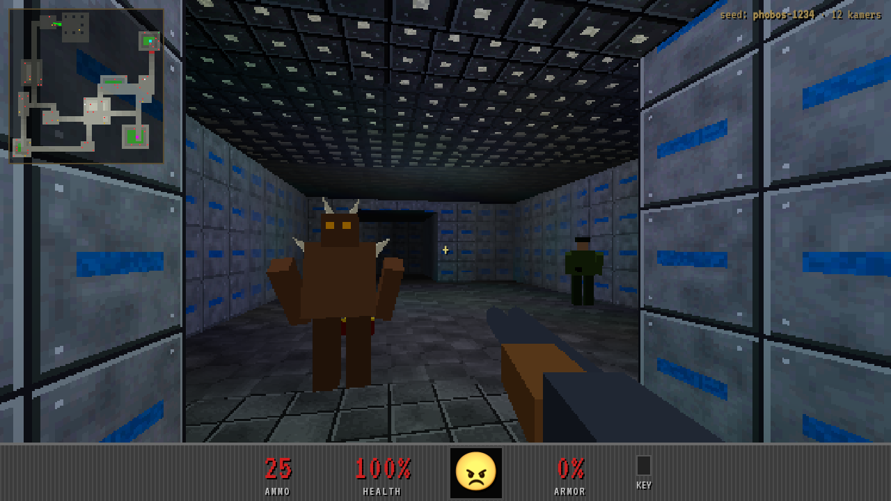
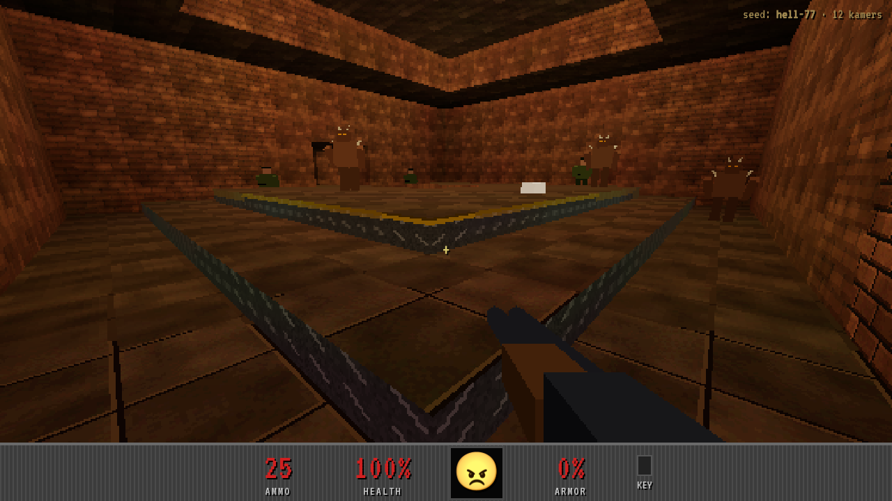
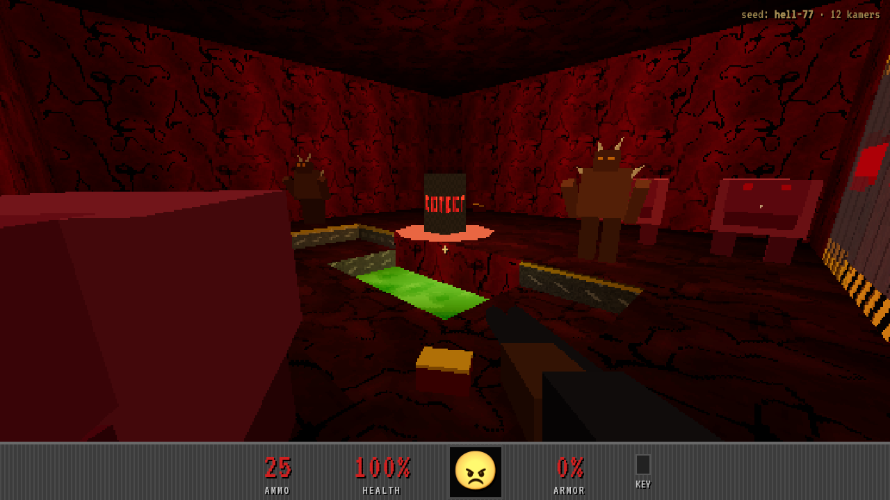

# Retro Shooter

Een Doom/Quake-achtige retro shooter in **echte 3D**, gebouwd met Vite + React + TypeScript,
three.js (via React Three Fiber) en Rapier physics. Levels worden procedureel gegenereerd uit een seed.

| Tech-basis | Brick-zaal met dais | Hell-exitkamer met nukage |
|---|---|---|
|  |  |  |

## Starten

```bash
npm install
npm run dev      # http://localhost:5173  (?seed=phobos-1234 voor een vast level)
npm test         # generator-tests (determinisme + speelbaarheid over 150 seeds)
npm run build
```

**Besturing:** WASD/pijltjes lopen · muis kijken · klik schieten (machine gun: ingedrukt houden) ·
1–5 of scrollwiel: heavy pistol / shotgun / machine gun / rocket launcher / disk launcher · spatie springen (ingedrukt houden = bunnyhop) ·
M kaart · N noclip · G nieuw level · Esc pauze.

**Mobiel (landscape):** linkerduim = zwevende joystick · rechterduim slepen = kijken · 🔥 = schieten
(vasthouden en slepen om te richten) · ⤒ = springen · tik op een wapenicoon om te wisselen. Houd je telefoon
opzij; in portretstand verschijnt een melding. Op Android gaat het spel fullscreen in landscape; op iPhone werkt
"Zet op beginscherm" het best (dan start het fullscreen).

**Moeilijkheid:** op telefoons krijg je de helft van de schade en doe je 1,5× zoveel schade (mikken met je duim is
lastiger). Forceren kan met `?difficulty=mobiel` of `?difficulty=normaal`.

**Doel:** vind de rode sleutel, open de rode deur en bereik de EXIT.

## Wat er nu is

- **Procedurele levelgenerator** (`src/game/level/generate.ts`)
  - kamers + minimum spanning tree + extra lussen (Doom-achtige rondjes)
  - hoogteverschillen: elke kamer een eigen vloerniveau, gangen worden automatisch trappen
  - features: pilaren, verhoogde platforms (dais), nukage-putten, hoge zaalplafonds
  - thema's op basis van diepte: tech-basis → brick → hell
  - start, sleutel en exit op bladeren van de boom; de exitkamer zit achter rode deuren
  - elk level wordt gevalideerd (bereikbaarheid met/zonder sleutel); anders opnieuw proberen
- **Gebakken vertex-belichting** met line-of-sight per lamp (geen licht door muren) en Doom-achtige lichtniveaus
- **Procedurele pixel-art textures** (64×64, posterized, `NearestFilter`), allemaal op een canvas getekend
- **Quake-achtige movement**: grondwrijving, acceleratie, air strafing en bunnyhop, met een vaste tijdstap van 120 Hz
  en Rapier character controller (autostep voor trappen)
- Low-res rendering (300px hoog, pixelig opgeschaald) + fog
- **Wapens** (`src/game/combat/weapons.ts`): heavy pistol, shotgun (8 hagels), machine gun (automatisch) en
  rocket launcher; hitscan via Rapier-raycasts, terugslag, view punch en drie munitiesoorten (bullets/shells/rockets)
- **Raketten en explosies** (`src/game/combat/explosions.ts`): projectiel met rookspoor, splash damage die niet
  door muren gaat, self-damage en knockback, dus rocket jumps (recht naar beneden schieten + springen)
- **Effecten** (`src/game/combat/Effects.tsx`): gloeiende lichtsporen, vonken, stof, bloed, kogelgaten, inslagflitsen
  en explosies, allemaal uit vaste pools
- **Vijand-AI** (`src/game/enemies/`): idle → wakker (zien of schoten horen) → achtervolgen via een gedeeld
  flow field → aanvallen → pijn → dood
  - grunt: hitscan-geweer (minder raak op afstand en als je rent)
  - imp: vuurballen die je kunt ontwijken
  - demon: snel, valt aan met een beet
- **Drops**: verslagen vijanden laten soms iets vallen (grunt: kogels/stimpack, imp: shells/stimpack,
  demon: stimpack/raket/shells); bij weinig health valt er vaker een stimpack
- **Disk launcher** (`src/game/combat/Disks.tsx`): liggende cirkelzaag die 5× stuitert (hoek van inval = hoek van
  uitval) en door vijanden heen snijdt; elke geraakte vijand krijgt schade. Klang + vonken tegen muren, scheurend
  geluid + bloed bij vijanden; in het viewmodel vliegt de schijf weg en schuift er een nieuwe van onderen in
- **Beretta-pistool** (`src/game/render/beretta.ts`): gedetailleerd model uit geëxtrudeerde zijprofielen met
  afgeronde randen (open slede met zichtbare loop, haan, decocker, vizieren met witte stippen, trekkerbeugel),
  procedurele textures met normal maps (gestraald staal, kartels, gravure "PIETRO BERETTA", geruite grip met
  medaillon en schroeven) en een terugslaande slede bij elk schot
- **Viewmodel-laag** (`src/game/player/ViewmodelCanvas.tsx`): wapens worden in een eigen canvas op hogere resolutie
  getekend, met belichting die meekleurt met het level en reflecties; de wereld blijft retro-pixelig
- Positionele audio: volume op afstand en stereo-panning t.o.v. je kijkrichting
- HUD met wapenminiaturen (offscreen gerenderd uit de 3D-modellen), geselecteerd wapen gehighlight, kills-teller
  en een rode flits bij schade
- Low-poly placeholder-vijanden (grunt, imp, demon), pickups, sleutel, deuren, exit, automap
- Gesynthetiseerde geluidseffecten (WebAudio); het pistool gebruikt een opgenomen sample
  (`src/assets/sounds/pistol.ogg`, met `.m4a` als terugval voor oudere Safari)

## Architectuur

```
src/
  game/
    level/    generator, validatie, level-mesh, deuren, things
    combat/   wapendefinities, raycasts/runtime, effecten
    enemies/  AI, flow-field pathfinding, projectielen
    player/   input, movement (Quake-fysica), Player-controller, wapen-viewmodel
    render/   textures, belichting, geometrie-builder, low-poly modellen
    store.ts  zustand: HUD/game-state (+ mutable `player` voor per-frame data)
    audio.ts  gesynthetiseerde SFX
  ui/         HUD en minimap (DOM over de canvas)
```

Belangrijkste regel: **geen React-state in de game loop.** Per-frame logica draait in `useFrame` en muteert
refs/objecten; React-state alleen voor HUD/menu's.

In dev-modus zijn `window.__level`, `window.__player` en `window.__teleport(x, y, z, yaw, pitch)` beschikbaar
om gegenereerde levels te inspecteren.

## Volgende stappen

1. Wapens als pickups in het level in plaats van alles vanaf de start
2. Echte low-poly modellen (glTF) met animaties en samples in plaats van de placeholders
3. Meer generator-variatie: liften, secrets, ramen tussen kamers, buitenruimtes met lucht
4. Balancing: aantal vijanden per kamer, munitie en health over het level
